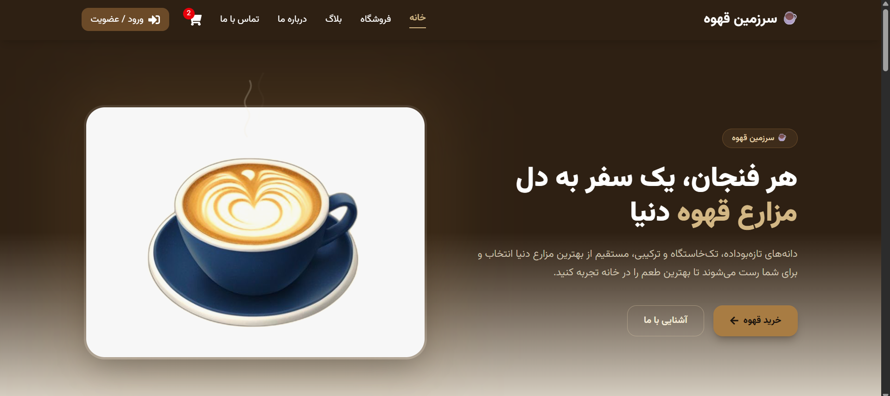

# ☕ The Coffee Land

A full-featured coffee shop e-commerce application built with React 19, featuring a customer storefront, authentication, shopping cart, checkout, and a complete admin dashboard connected to a real Node.js REST API and PostgreSQL database.

[](https://react.dev/)
[](https://nodejs.org/)
[](https://www.postgresql.org/)

---

## Overview

The Coffee Land is a full-stack coffee shop e-commerce application designed to simulate a real-world online store.

The project includes two main areas:

- **Customer storefront** for browsing products, managing a cart, authenticating, and placing orders.
- **Admin dashboard** for managing products, categories, orders, customers, coupons, reviews, articles, and store settings.

Unlike a frontend-only mockup, the application communicates with a real backend API and PostgreSQL database. Orders created through the customer checkout are stored in the same database and become available in the admin dashboard.

---

## Features

### Customer Storefront

- Responsive home, shop, product detail, cart, and checkout pages
- Product search, filtering, sorting, and category browsing
- Shopping cart with quantity management
- Discount and free-shipping calculations
- Checkout form with client-side validation
- User registration and authentication
- Protected and guest-only routes
- Role-based access control
- Blog and article pages
- Toast notifications
- Order success flow

### Admin Dashboard

- Dashboard with sales statistics and charts
- Product management
  - Create products
  - Edit products
  - Manage pricing and inventory
  - Assign categories
- Category management
- Order management
- Order status updates
- Coupon management
- Customer management
- Review management
- Article management
- Store settings
- Delete confirmation flows

---

## Tech Stack

### Frontend

| Technology | Purpose |
|---|---|
| React 19 | UI development |
| React Router 7 | Client-side routing |
| Tailwind CSS v4 | Styling and responsive UI |
| React Hook Form | Form management |
| Zod | Form validation |
| React Context API | State management |
| Recharts | Admin dashboard charts |
| react-icons | Icons |
| Vitest | Unit testing |
| React Testing Library | Component testing |
| Vite | Development and build tooling |

### Backend

| Technology | Purpose |
|---|---|
| Node.js | Backend runtime |
| REST API | Client-server communication |
| PostgreSQL | Database |
| JWT | Authentication |
| bcrypt | Password hashing |
| Vercel | Deployment |

Backend repository:

**[Coffee Land Backend](https://github.com/yektaakhavan/coffee-land-backend)**

---

## Project Structure

```text
src/
├── assets/
│   ├── fonts/
│   └── images/
│
├── components/
│   ├── admin/
│   ├── checkout/
│   ├── layout/
│   ├── shared/
│   ├── shop/
│   └── ui/
│
├── constants/
│
├── context/
│   ├── AuthContext
│   ├── CartContext
│   ├── OrderContext
│   ├── ProductContext
│   ├── CategoryContext
│   └── ToastContext
│
├── data/
│
├── lib/
│   └── api.js
│
├── pages/
│   ├── admin/
│   ├── auth/
│   └── public/
│
├── utils/
│
├── validation/
│
└── routes.jsx
````

---

## Key Implementation Details

### Context-based State Management

The application uses React Context API to separate state into independent domains such as:

* Authentication
* Cart
* Products
* Categories
* Orders
* Toast notifications

This keeps each domain isolated and makes the application easier to understand and maintain.

### API Adapter Layer

All backend communication goes through a centralized API utility:

```text
src/lib/api.js
```

The context layer communicates with the backend through this API wrapper and maps backend response data into the structures expected by the UI.

This keeps API-specific logic out of presentation components.

### Server-side Price Validation

Product prices are never trusted from the client during checkout.

When an order is placed, the backend retrieves the current product prices from the database and calculates the order total server-side.

This prevents a client from manipulating the product price before submitting an order.

### Transaction-safe Stock Management

Order creation uses a PostgreSQL transaction with row-level locking.

This prevents two simultaneous customers from successfully purchasing the final available unit of the same product.

### Authentication & Authorization

The application uses:

* JWT-based authentication
* bcrypt password hashing
* Protected routes
* Guest-only routes
* Role-based access control

Administrative actions are restricted to authenticated users with the appropriate role.

---

## Testing

The project includes unit and component tests using **Vitest** and **React Testing Library**.

Tested areas include:

* Price calculation
* Order normalization
* Price formatting
* Product card rendering
* Discount display
* Out-of-stock state
* Product links
* Image lazy loading

Run the test suite with:

```bash
npm run test
```

---

## Performance

Several frontend performance techniques are implemented:

* Route-based code splitting with `React.lazy`
* Lazy loading for product images
* Asynchronous image decoding
* `React.memo` for reusable product cards
* Production build optimization through Vite

---

## Design

The interface follows a custom coffee-inspired visual system.

* Warm espresso and brass color palette
* Vazirmatn variable font
* RTL-first layout
* Responsive design
* Consistent image treatment
* Subtle scroll and hover animations
* Responsive customer storefront and admin dashboard

---

## Screenshots

### Customer Storefront



### Admin Dashboard

<!-- Add admin dashboard screenshot here -->

---

## Getting Started

### Prerequisites

Make sure you have the following installed:

* Node.js
* npm
* PostgreSQL

### Installation

Clone the repository:

```bash
git clone https://github.com/yektaakhavan/The-Coffee-Land.git
cd The-Coffee-Land
```

Install dependencies:

```bash
npm install
```

Create your environment file:

```bash
cp .env.example .env
```

Set your backend API URL in `.env`:

```env
VITE_API_URL=your_backend_url
```

Start the development server:

```bash
npm run dev
```

The application will be available at:

```text
http://localhost:5173
```

---

## Available Scripts

| Command           | Description                  |
| ----------------- | ---------------------------- |
| `npm run dev`     | Start the development server |
| `npm run build`   | Create a production build    |
| `npm run preview` | Preview the production build |
| `npm run test`    | Run the test suite           |
| `npm run lint`    | Run ESLint                   |

---

## Roadmap

* [ ] Payment gateway sandbox integration
* [ ] Direct product image upload
* [ ] Phone-number authentication
* [ ] English / Persian language switcher

آخر همه ی readme هام


## 👨‍💻 Author

**Yekta Akhavan**

<p align="center">
  <a href="mailto:yekta.akhavan.dev@gmail.com">
    
  </a>
  &nbsp;
  <a href="https://www.linkedin.com/in/yekta-akhavan/">
    
  </a>
  &nbsp;
  <a href="https://www.instagram.com/yektaakhavan.dev?igsi=d2Vya2RqazhqZ2Z2">
    
  </a>
  &nbsp;
  <a href="https://yekta-akhavan.vercel.app/">
    
  </a>
</p>
